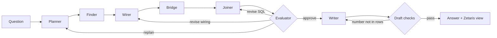

# Fieldwork

Ask a question about a Montgomery, Alabama neighborhood. Fieldwork's agents find the public data that can answer it, register it in Zetaris, join it across sources, check the result in code, and show the record behind every number.

**Live Desk:** https://fieldwork.38-49-216-59.sslip.io

Latest full batch: **21/25** (median 98.4 s, p90 198.6 s) on a frozen set of 25 questions, graded in code. Every batch, failures included, is on the [Evaluation page](https://fieldwork.38-49-216-59.sslip.io/evaluation).

> "Which Montgomery census tracts have the highest adult asthma rates, and how many code violations did each have?"
>
> Fieldwork searches the city's open data hub and the CDC catalog, picks *Code Violations* and *CDC PLACES*, reads every record through Zetaris, places each violation in its census tract, joins the two sources by tract, checks the arithmetic independently, and writes a short answer with a map, a chart, the SQL and a trace of every step.

Answering this used to mean an analyst finding the datasets, cleaning them, geocoding records into tracts and joining them by hand. Fieldwork does it live, in a few minutes, and shows its work.

## Contents

- [What you see](#what-you-see)
- [How it works](#how-it-works)
- [Checks that decide what you see](#checks-that-decide-what-you-see)
- [Sponsor technology](#sponsor-technology)
- [Evaluation](#evaluation)
- [Run it yourself](#run-it-yourself)
- [Repository layout](#repository-layout)
- [Privacy and scope](#privacy-and-scope)
- [Why this matters](#why-this-matters)
- [License](#license)

## What you see

| Page | What it shows |
| --- | --- |
| **Desk** (`/`) | Ask anything, or pick a sample question. The latest answer is featured. |
| **Live run** | Each agent's step as it happens: datasets considered, filters, record counts, SQL, check results, and which model served each request. |
| **Answer** | Headline, supporting points, how sure Fieldwork is, caveats, a tract map, a chart, the result rows, the SQL, and the formula and source rows behind every computed figure. |
| **History** (`/history`) | Earlier answers, replayable step by step. |
| **Check it yourself** (`/check`) | The public documents behind the need, with exact quotations and retrieval dates. |
| **Evaluation** (`/evaluation`) | Every full question-set batch, including failures, with per-step timings. |
| **Settings** (`/settings`) | Connect a Meterless Runtime by pasting its connect link. |

Every answer is also saved in Zetaris as a view (`fieldwork_answers.answer_<id>`), so it can be queried with SQL alongside the sources it came from.

## How it works



| Agent | Job |
| --- | --- |
| **Planner** | Turns the question into a plan: geography, years, measures, output shape, and whether counts or population rates answer it. Refuses out-of-scope questions before any data is fetched. |
| **Finder** | Searches the Montgomery open data hub (ArcGIS) and the CDC catalog (Socrata) for each measure, and picks a dataset. Recalls earlier verified choices from H-MEM. |
| **Wirer** | Reads the chosen dataset's real schema, writes its filter, tests the request through Zetaris (`TEST REST REQUEST`), registers it as a REST session table, and confirms the row count matches the source's own count. |
| **Bridge** | Reads census tract boundaries from the Census Bureau through Zetaris, places every located record inside its tract, removes duplicate case IDs, and saves de-identified tract counts to Postgres, which Zetaris reads as a registered data source. |
| **Joiner** | Writes one Zetaris SQL query that answers the plan. Common analysis shapes compile from verified templates; anything else is written by the model and checked the same way. |
| **Evaluator** | Runs the independent code checks, then asks a model whether the result answers the question. It can send the work back to the Joiner, the Wirer or the Planner, for up to three rounds. |
| **Writer** | Writes the answer from the result rows and figures computed in code. Every sentence is checked against the rows; a draft with a number that is not in the data goes back with the exact problem, up to three drafts. |

Each run has a fixed allowance of model calls (eight on the first pass, three more for each extra Evaluator round), and Fieldwork has a daily cap. Free model routes are the default; paid routes stay off unless `FW_ALLOW_PAID_MODELS` is set.

## Checks that decide what you see

The model never has the last word on a number. These checks run in code, against data Fieldwork reads independently of the query being checked:

- **Row counts:** the rows read through Zetaris match the source's own published count.
- **Tract placement:** how many records were located, placed inside a tract, or had no location.
- **Rate arithmetic:** every displayed rate is recomputed from raw counts and the named population field.
- **Ranking order:** results are sorted by the measure the question ranks.
- **Membership:** zero-count and positive-count lists match the independently counted tracts exactly, with no omissions or extras.
- **Paired sets:** correlations use every eligible tract once, with missing pairs excluded on both sides.
- **Latest inspections:** score thresholds apply after the latest inspection per establishment is selected.
- **Category totals:** category counts match an independent aggregation of the source.
- **Coverage and dates:** partial years and missing months are detected and disclosed.
- **Sample size:** small groups are flagged and disclosed, never silently dropped.
- **Draft numbers:** every number in the answer appears in the result rows or in a figure computed in code.

If a requested SQL change fails one of these checks, Fieldwork keeps the earlier query that passed them all and says so in the answer.

## Sponsor technology

| Technology | What it does in Fieldwork | Measured | Check it |
| --- | --- | --- | --- |
| Zetaris Lightning | Every source record and every answer passes through it | Each run checks its row counts against the source's own count | Live run page, `evidence/runs/` |
| Zetaris USL and data quality | The `montgomery_neighborhoods` model over Fieldwork's tract tables | 6/6 data-quality checks pass; 291,381/291,381 tract counts refer to a real tract | `npm run governed-model`, `evidence/governed-capabilities.json` |
| Zetaris lineage | Source tables of each saved answer, from `INFER SQLTABLE SOURCES` | The saved view's sources matched the answer's query on a recorded run | `evidence/lineage-proof.json` |
| Recipes for zetaris/getting-started | Discovered sources exported in that repo's own format | 3 recipes verified live: 71, 15,439 and 71 records | `npm run recipe:verify`, `evidence/recipes/drafts.json` |
| Meterless H-MEM | Source memory shared across runs | H-MEM conformance 13/13 | `npm run conformance:hmem` |
| Meterless World Model | Each run's entities and relationships | World Model conformance 8/8 | `npm run conformance:world` |
| Meterless Markovian | Bounded Writer state over long tables (off by default) | Markovian conformance 8/8 | `npm run conformance:markovian` |
| Meterless Scout Intent | Signed contracts; inspects untrusted source metadata (off by default) | Scout harness 32/32 examples; 30/30 poisoned descriptions blocked, 0/25 real ones | `npm run conformance:scout`, `evidence/scout/` |
| Meterless Runtime provider | Primary model route when a Runtime is reachable | Contract test server | `tools/contract-runtime` |
| NVIDIA Nemotron | Every model request | The model that served each request is in every trace | Live run page |

### Zetaris: the data layer

All source data flows through Zetaris Lightning:

- `TEST REST REQUEST` checks each source endpoint before anything is registered.
- `CREATE REST SESSION TABLE` registers each dataset page as a queryable table: Socrata JSON lists directly, and ArcGIS feature responses with their `features` list exploded into rows.
- `REGISTER DATASOURCE TABLE ... FROM fw_pg` makes Fieldwork's tract boundaries, tract counts and de-identified observations queryable next to the live sources.
- The Joiner's query runs in Zetaris, through the SQL API.
- `CREATE SCHEMASTORE CONTAINER` and `CREATE SCHEMASTORE VIEW` save each answer as a view in `fieldwork_answers`.
- A read-only guard (`packages/zetaris/src/sql.ts`) refuses any model-written statement that could change data.
- A Unified Semantic Layer model, `montgomery_neighborhoods`, is activated over the tract and tract-count tables. Its keys and data-quality rules check what every join relies on ([docs/governed-model.md](docs/governed-model.md)). With `FW_ANSWER_DQ=1`, the results appear on each tract answer.
- With `FW_ANSWER_LINEAGE=1`, each answer shows the source tables Zetaris reports for its saved view.

Fieldwork also contributes back. A verified recipe fix is open upstream: [zetaris/getting-started#36](https://github.com/zetaris/getting-started/pull/36). Sources Fieldwork discovers can be exported as recipes in that repo's own format and verified against a live Zetaris instance ([docs/recipes.md](docs/recipes.md)).

### Meterless: memory, world model and runtime

- **H-MEM engine** (`packages/hmem`): source memory. Each run stores which datasets answered which needs, which filters worked and which failed, with trust feedback on every memory it recalled. The Finder reuses a verified choice without a model call. Memories persist in Postgres. Meterless's own conformance suite runs against this module: `npm run conformance:hmem`.
- **World Model** (`packages/world`): Fieldwork's own implementation of the Meterless World Model. Each run's sources, tracts, findings and Evaluator challenges become entities with stable keys and relationship provenance. It passes Meterless's unmodified conformance suite: `npm run conformance:world`.
- **Markovian** (`packages/markovian`): Fieldwork's own implementation of the Meterless Markovian engine. With `FW_MARKOVIAN_WRITER=1`, the Writer reads long tract tables in bounded chunks and carries forward only facts that pass the answer checks. It passes Meterless's unmodified conformance runner: `npm run conformance:markovian`.
- **Scout Intent** (`packages/scout`): Fieldwork's own implementation of the Meterless Scout Intent engine. With `FW_SCOUT_GUARD=1`, each question gets a signed execution contract, and dataset titles, descriptions and columns written by strangers on public portals are inspected before they reach a prompt ([docs/scout.md](docs/scout.md)). It passes Meterless's unmodified evaluation harness: `npm run conformance:scout`.
- **Meterless Runtime provider** (`packages/llm/src/meterless.ts`): implements the Runtime 1.4 provider contract (v4). Fieldwork tries the Runtime first and reports its status on every run. `tools/contract-runtime` is a contract test server for this provider.

### NVIDIA Nemotron: every agent

Every agent runs on NVIDIA Nemotron: `nemotron-3.5-super-vl` for planning, SQL and evaluation, and `nemotron-3.5-lightning` for search, wiring and writing. When no Meterless Runtime is reachable, the requests go through OpenRouter. Each role has a second model route, which is asked only after the first has taken 30 seconds. The trace records the model that served every request.

Two more Nemotron models are built in and off by default. `nemotron-3.5-content-safety` gives suspicious source metadata a second check under Scout. `nemotron-3.5-embed-8b` (with the 1B model as fallback) ranks discovered datasets against each measure, with vectors cached in Postgres, under `FW_FINDER_EMBEDDINGS=1` ([docs/embeddings.md](docs/embeddings.md)).

## Evaluation

Fieldwork is measured on a frozen set of 25 questions ([`evidence/questions.json`](evidence/questions.json)):

- **20 answerable questions** about code violations, 311 requests, 911 calls, food inspections, pharmacies, emergency shelters, building permits, EPA-listed facilities and CDC health estimates, by census tract or citywide.
- **5 questions that must be refused:** another city, a price prediction, named residents' health, private bank balances, and medical advice.

Each question is graded in code against an independent reference read from the sources: source choice, tract identifiers, sort order, recomputed rates and differences, membership, disclosures and refusals. The question file is fingerprinted, and any change to a question or to a grading rule is recorded as an amendment with its reason.

Every full batch is published, including failures, with step timings: see the [Evaluation page](https://fieldwork.38-49-216-59.sslip.io/evaluation) or [`evidence/EVAL.md`](evidence/EVAL.md). The raw results and traces are under [`evidence/question-set/`](evidence/question-set/) and [`evidence/runs/`](evidence/runs/).

### Portability

Fieldwork was pointed at Louisville, Kentucky with no Louisville-specific code. It found the city's property-maintenance violations and CDC PLACES cold. The first three runs failed or ended partial. The city layer holds only the last 30 days, CDC publishes no asthma estimate for Kentucky tracts, and a query template sorted by a supporting measure. After two generic fixes, a question about violations and short sleep answered in 92 s with 7 model calls. Every run, failure and open item is in [docs/portability.md](docs/portability.md) and on the Evaluation page.

## Run it yourself

### Requirements

- Node.js 22 or later
- Zetaris (the local Docker bundle, about 8 GB of memory and 4 CPUs, or a managed cluster)
- PostgreSQL for Fieldwork's runs, traces, memory and tract tables
- An OpenRouter key for the free Nemotron routes, or a Meterless Runtime

### Set up

```bash
git clone https://github.com/Jennycruzy/fieldwork.git
cd fieldwork
npm ci
cp .env.example .env   # then fill it in
```

| Setting | Purpose |
| --- | --- |
| `ZETARIS_URL`, `ZETARIS_EMAIL`, `ZETARIS_PASSWORD` | Zetaris instance and login |
| `FW_PG_URL` | Fieldwork's Postgres |
| `METERLESS_BASE_URL`, `METERLESS_RUNTIME_TOKEN`, `METERLESS_MODEL` | Meterless Runtime (primary provider) |
| `OPENROUTER_API_KEY` | Nemotron through OpenRouter when no Runtime is reachable |
| `FW_DAILY_CALLS` | Daily model-call cap (default 45) |
| `FW_PORT`, `FW_HOST` | Desk and API address |
| `FW_ANSWER_LINEAGE`, `FW_ANSWER_DQ` | Zetaris lineage and data-quality results on each answer (off by default) |
| `FW_MARKOVIAN_WRITER`, `FW_SCOUT_GUARD`, `FW_FINDER_EMBEDDINGS` | Markovian Writer, Scout inspection, embedding ranking (off by default) |
| `FW_PLACE`, `FW_FRESH_MEMORY` | Portability runs: another place, and an empty unsaved source memory |

### Use it

```bash
npm run ask -- "Which Montgomery census tracts had the most 311 service requests in 2025?"   # one run in the terminal
npm start                  # Desk and API
npm run sample             # Desk with recorded runs, no model calls
npm run questions          # run the full question set
```

### Check it

```bash
npm run typecheck
npm test                   # unit and integration tests
npm run conformance:hmem   # Meterless H-MEM conformance
npm run conformance:world  # Meterless World Model conformance
npm run conformance:markovian  # Meterless Markovian conformance
npm run conformance:scout  # Meterless Scout Intent evaluation harness
npm run check:claims       # every number in this README against its evidence
npm run format:check
npm run wordscan
npm run build
```

CI runs all of these on every push. `deploy/fieldwork.service` is the systemd unit used for the live Desk; it builds the web app, then starts the API on loopback behind nginx.

## Repository layout

```text
apps/
  api/          Fastify API, the agent run, CLI and Postgres store
    src/agents/ Planner, Finder, Wirer, Bridge, Joiner, Evaluator, Writer
  web/          React Desk: live runs, answers, map, charts, history, evaluation
packages/
  core/         Plan and answer types, code checks, figure ledger, question-set grader
  sources/      Montgomery ArcGIS hub, Socrata/CDC catalogs, tract bridge, filters
  zetaris/      Zetaris client, Lightning SQL shapes, read-only SQL guard
  llm/          Model chain with route fallback, OpenRouter and Meterless providers
  hmem/         Meterless H-MEM engine and Fieldwork's source memory
  world/        World Model implementation, tested by Meterless's conformance suite
  markovian/    Markovian engine implementation, tested by Meterless's conformance runner
  scout/        Scout Intent implementation, tested by Meterless's evaluation harness
  embeddings/   Nemotron embedding ranking and its Postgres vector cache
  recipes/      Recipe export in zetaris/getting-started's format
docs/           Governed model, recipes, Scout, embeddings, portability
scripts/        Question-set runner, evaluation publisher, live-path browser check, privacy scan, claims check
tools/          Meterless provider contract test server
evidence/       Question set, batch results, run traces, need sources
```

## Privacy and scope

- Fieldwork answers questions about Montgomery, Alabama from public sources. Other places, predictions, questions about named people, private finances and medical advice are refused before any data is fetched.
- Personal names, addresses and other private fields are never selected or stored. Records are reduced to de-identified observations (tract, date, category, value) before counting.
- Answers describe public records and CDC model-based estimates. They do not establish cause, and the answer page says so where it matters (for example, a facility listing is not a measure of exposure).
- `scripts/privacy-check.py` scans committed evidence for record-level identifiers and keys.

## Why this matters

City staff, health departments and residents need neighborhood answers that combine city records with health data, and the work of finding, cleaning and joining those sources keeps them out of reach. [`evidence/need.md`](evidence/need.md) collects five primary documents, including Montgomery blight reporting and CDC guidance, that describe this need. Each has an exact quotation and its retrieval date, also linked from the Desk's [check page](https://fieldwork.38-49-216-59.sslip.io/check). They establish a use for public information; they do not measure Fieldwork's own adoption or benefit.

## License

MIT. The adapted Meterless H-MEM engine and both Meterless conformance suites are Apache License 2.0; see [`THIRD_PARTY_NOTICES.md`](THIRD_PARTY_NOTICES.md).
